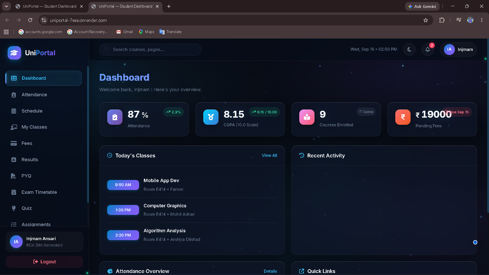
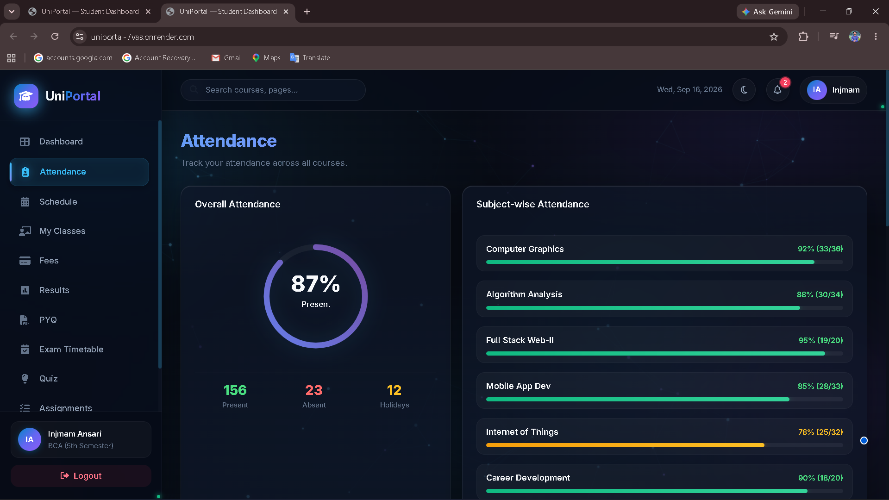
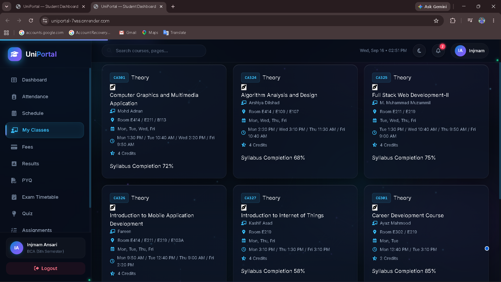
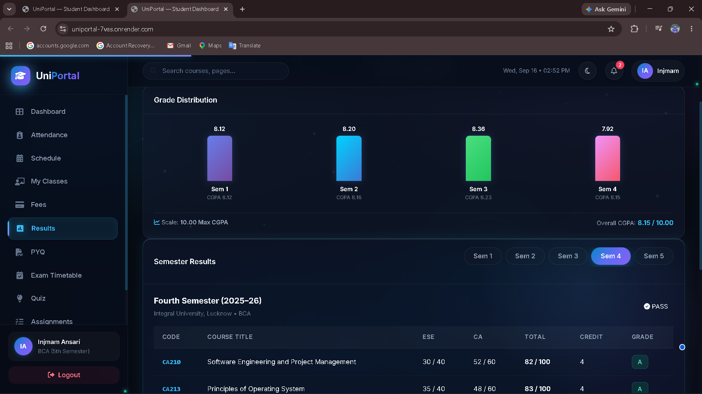
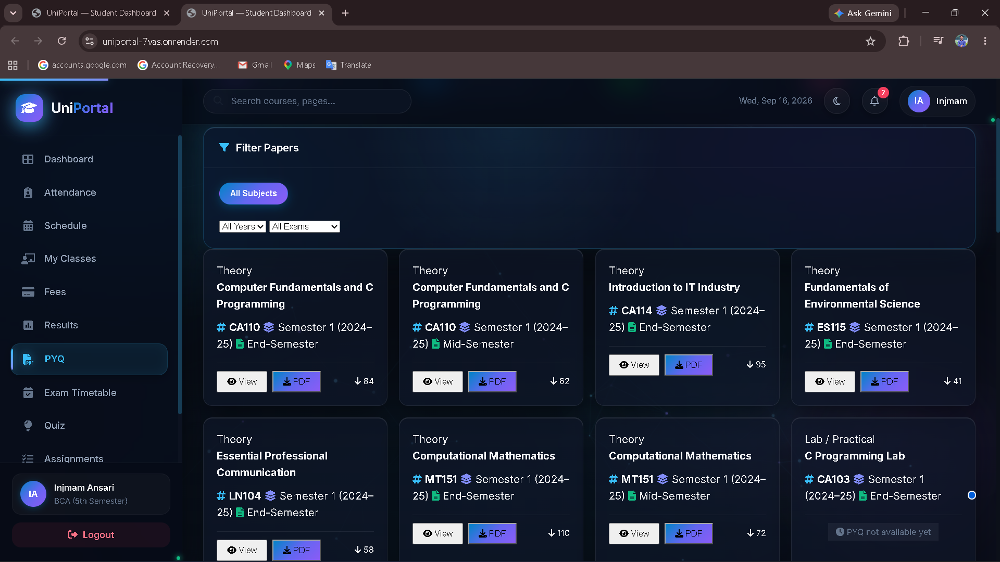
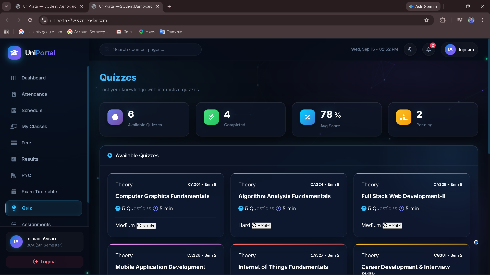
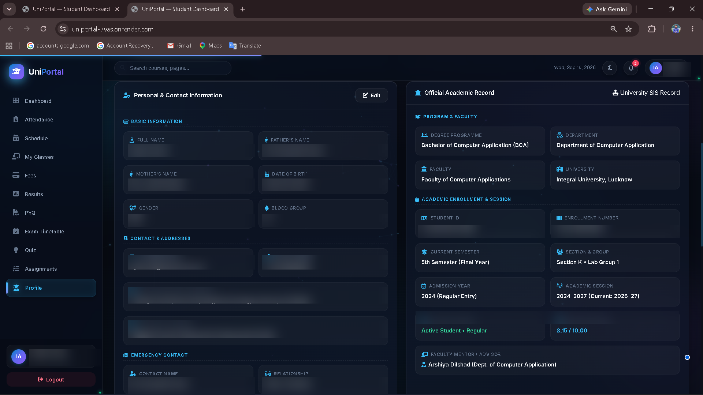
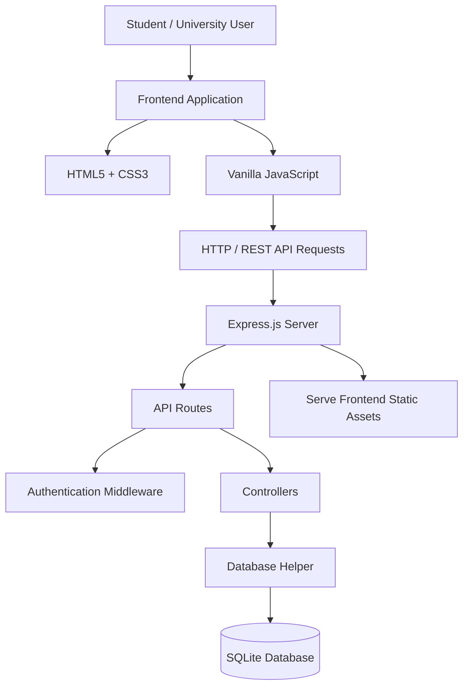

# 🎓 UniPortal — Your Academic World, One Dashboard

<p align="center">
  <strong>A Modern Full-Stack Student Management & Academic Information Platform</strong>
</p>

<p align="center">
  Manage academic records, track attendance, explore courses, check results, access question papers, and stay connected with your university activities.
</p>

<p align="center">
  <a href="https://uniportal-7-vas.onrender.com">🌐 Live Demo</a> •
  <a href="#-screenshots">Screenshots</a> •
  <a href="#-features">Features</a> •
  <a href="#-getting-started">Getting Started</a>
</p>

<p align="center">
  
  
  
  
  
</p>

---

## ✨ Overview

**UniPortal** is a full-stack Student Management System designed to bring essential university activities and academic information into one centralized platform.

Built with a Vanilla JavaScript frontend, Node.js, Express.js, and SQLite, the application provides a student-focused dashboard for accessing academic records, monitoring attendance, viewing schedules, checking semester results, managing fee information, attempting quizzes, tracking assignments, and accessing Previous Year Question Papers (PYQs).

The application also includes authentication, profile management, student document records, notifications, and activity information.

UniPortal uses Express.js to serve both the frontend and backend APIs, keeping the application organized as a single full-stack web application.

## 🚀 Features

### 🎓 Student Dashboard

A centralized dashboard provides an overview of important academic information.

- Student overview and profile information
- Academic status and dashboard statistics
- Attendance percentage
- CGPA on a 10.00-point scale
- Enrolled courses
- Pending fee overview
- Today's classes
- Recent activity
- Quick navigation to academic modules

### 👤 Authentication & Profile Management

- Username and password authentication
- Password hashing with bcryptjs
- JWT-based authentication
- Authenticated profile retrieval
- Student profile updates
- Password-change workflow
- Student and academic information
- Contact and emergency information
- Student document records

### 📅 Academic Management

- Weekly class timetable
- Today's class schedule
- Course catalog
- Course and class information
- Attendance records
- Subject-wise attendance
- Semester examination results
- SGPA and CGPA information
- Academic progress tracking

### 💳 Fees & Payment Records

UniPortal provides an overview of university fee information and payment records.

- Fee component overview
- Paid and pending fee status
- Payment due dates
- Payment transaction records
- Payment history

> Payment functionality is an application/demo workflow. It is not a production payment gateway integration.

### 🧠 Learning & Assessment

- Online quizzes
- Subject-wise quiz listings
- Quiz submission
- Quiz scores and history
- Assignment tracking
- Assignment submission records
- Previous Year Question Paper listing
- Semester and examination-based paper information

### 📄 Student Documents

The application maintains student document records and related academic information.

- Student identity records
- Enrollment information
- Marksheet and grade-sheet records
- Fee receipt records
- Certificate records
- Document metadata and status

### 🔔 Notifications & Activity

- Academic notifications
- Fee reminders
- Assignment notifications
- Examination updates
- Recent student activity
- Read and unread notification status

### 🎨 Responsive User Interface

- Modern academic dashboard
- Sidebar navigation
- Responsive layouts
- Dark-themed interface
- Animated visual effects
- Interactive cards and components
- Search interface
- Student-focused navigation
- Dashboard visualizations

## 📸 Screenshots

Explore the UniPortal application and its academic modules.

| 🎓 Student Dashboard | 📊 Attendance |
|---|---|
|  |  |

| 📚 My Classes | 🏆 Semester Results |
|---|---|
|  |  |

| 📄 PYQ Library | 🧠 Quizzes |
|---|---|
|  |  |

### 👤 Student Profile



## 🧰 Technology Stack

| Category | Technology |
|---|---|
| Frontend Structure | HTML5 |
| Styling | CSS3 |
| Frontend Logic | Vanilla JavaScript |
| Backend Runtime | Node.js |
| Backend Framework | Express.js 4 |
| Database | SQLite |
| Database API | Node.js `node:sqlite` |
| Authentication | JSON Web Token (JWT) |
| Password Security | bcryptjs |
| Configuration | dotenv |
| Cross-Origin Support | CORS |
| Testing | Node.js HTTP test suite |

## 🏗️ Application Architecture

UniPortal follows a straightforward full-stack architecture where Express.js serves the frontend, exposes REST-style API routes, and communicates with the SQLite database.



### Application Components

| Component | Responsibility |
|---|---|
| Frontend | Dashboard UI and academic navigation |
| JavaScript API Client | Frontend interactions and API requests |
| Express.js | Application server and API handling |
| Routes | Organize application endpoints |
| Middleware | Authentication and role checking |
| Controllers | Handle application workflows |
| Database Helper | SQLite queries and initialization |
| SQLite | Persistent relational data storage |

## 🗄️ Database Architecture

UniPortal uses SQLite with a relational database schema.

The database contains records related to:

- Users
- Students
- Student Documents
- Courses
- Schedule
- Attendance
- Results
- Semester GPA
- Fees
- Payments
- Quizzes
- Quiz History
- Assignments
- PYQ Papers
- Notifications
- Activity Logs

The database initialization process creates or verifies the schema and seeds initial demonstration records when the database is empty.

## 🔐 Authentication & Security

UniPortal includes application-level security mechanisms.

### Password Security

Passwords are hashed using `bcryptjs` before being stored in the database.

### JWT Authentication

Authenticated requests use the Bearer token format:

```http
Authorization: Bearer <token>
```

JWTs are issued after successful login and contain authenticated user information.

### Role-Based Authorization

The backend includes role-checking middleware for:

- `student`
- `teacher`
- `admin`

### Environment-Based Configuration

The application uses environment variables for runtime configuration, including the server port and JWT secret.

### Security Considerations

UniPortal is an educational and portfolio project, not production-ready university infrastructure.

Before using it with real student data or deploying it for actual institutional use, review the following:

- Remove tracked environment files from the repository.
- Rotate any genuine credentials that may have been committed.
- Use a strong, randomly generated JWT secret.
- Remove hardcoded fallback authentication secrets.
- Restrict CORS to trusted origins.
- Add rate limiting and brute-force protection.
- Apply input validation and sanitization.
- Review authorization on every sensitive endpoint.
- Protect document and file handling.
- Avoid exposing internal server errors.
- Use HTTPS and secure deployment configuration.
- Establish database backup and migration procedures.
- Remove personal and demonstration records.

**Important:** Never commit production credentials, API keys, private student records, or other sensitive information to GitHub.

## 🔌 API Overview

The Express.js backend exposes REST-style API route groups under `/api`.

| Module | API Base Path |
|---|---|
| Authentication | `/api/auth` |
| Student | `/api/student` |
| Schedule | `/api/schedule` |
| Attendance | `/api/attendance` |
| Results | `/api/results` |
| Fees | `/api/fees` |
| Quizzes | `/api/quizzes` |
| Assignments | `/api/assignments` |
| Previous Year Papers | `/api/pyq` |
| Dashboard | `/api/dashboard` |
| Health Check | `/api/health` |

### Health Check

The application provides a health endpoint:

```http
GET /api/health
```

Example response structure:

```json
{
  "status": "online",
  "service": "UniPortal Student Management System API",
  "timestamp": "2026-01-01T00:00:00.000Z",
  "database": "SQLite (Active & Seeded)"
}
```

The timestamp is generated dynamically by the server.

## 📂 Project Structure

```text
UniPortal/
│
├── backend/
│   ├── config/
│   │   └── db.js
│   │
│   ├── controllers/
│   │   ├── assignmentController.js
│   │   ├── attendanceController.js
│   │   ├── authController.js
│   │   ├── dashboardController.js
│   │   ├── feesController.js
│   │   ├── pyqController.js
│   │   ├── quizController.js
│   │   ├── resultsController.js
│   │   ├── scheduleController.js
│   │   └── studentController.js
│   │
│   ├── database/
│   │   ├── database.sqlite
│   │   ├── schema.sql
│   │   └── seed.js
│   │
│   ├── middleware/
│   │   └── authMiddleware.js
│   │
│   ├── routes/
│   │   ├── assignmentRoutes.js
│   │   ├── attendanceRoutes.js
│   │   ├── authRoutes.js
│   │   ├── dashboardRoutes.js
│   │   ├── feesRoutes.js
│   │   ├── pyqRoutes.js
│   │   ├── quizRoutes.js
│   │   ├── resultsRoutes.js
│   │   ├── scheduleRoutes.js
│   │   └── studentRoutes.js
│   │
│   ├── test/
│   │   └── api.test.js
│   │
│   ├── package.json
│   ├── package-lock.json
│   └── server.js
│
├── screenshots/
│   ├── 01-dashboard.png
│   ├── 02-attendance.png
│   ├── 03-my-classes.png
│   ├── 04-results.png
│   ├── 05-pyq-library.png
│   ├── 06-quizzes.png
│   └── 07-student-profile-redacted.png
│
├── extracted_images/
│
├── app.js
├── effects.css
├── effects.js
├── index.html
├── style.css
├── package.json
├── package-lock.json
├── .gitignore
└── README.md
```

## ⚙️ Getting Started

Follow these steps to run UniPortal locally.

### Prerequisites

- Node.js 22.13 or newer
- npm
- Git

UniPortal uses Node.js' built-in `node:sqlite` module. It was introduced in Node.js 22.5 and became available without the experimental command-line flag in Node.js 22.13. The API remains experimental in the Node.js 22 documentation.

Reference: [Node.js SQLite Documentation](https://nodejs.org/api/sqlite.html)

### 1. Clone the Repository

```bash
git clone https://github.com/injmam089/UniPortal.git
cd UniPortal
```

### 2. Install Dependencies

Run from the project root:

```bash
npm install
```

### 3. Configure Environment Variables

Create the following file:

```text
backend/.env
```

Add the required configuration:

```env
PORT=5000
NODE_ENV=development
JWT_SECRET=replace-with-a-long-random-secret
```

Generate your own strong JWT secret and never commit the real `.env` file.

### 4. Start the Application

```bash
npm start
```

The application will be available at:

```text
http://localhost:5000
```

### 5. Verify the API

Open the health-check endpoint:

```text
http://localhost:5000/api/health
```

A successful response indicates that the server is running.

## 🧪 Testing

UniPortal includes a Node.js API verification suite.

### 1. Start the Application

```bash
npm start
```

### 2. Open Another Terminal

From the project root, run:

```bash
npm test
```

The test suite checks important workflows such as:

- API health check
- Authentication
- Student profile retrieval
- Student profile updates
- Student documents
- Academic records
- Schedule
- Results
- Fees
- Quizzes
- Assignments
- Previous Year Question Papers
- Dashboard data

The included test suite expects the application to be available at `127.0.0.1:5000`.

## 📜 Available Scripts

The root `package.json` provides the following scripts:

| Command | Description |
|---|---|
| `npm start` | Start the Express.js application |
| `npm run dev` | Start the application in development mode |
| `npm test` | Run the API verification suite |

Both `start` and `dev` currently execute `node backend/server.js`.

## 🌐 Deployment

UniPortal is designed to run as a Node.js/Express application that serves both frontend assets and backend API endpoints.

The deployment environment should provide:

```text
PORT
NODE_ENV
JWT_SECRET
```

### Deployment Considerations

- Configure environment variables through the hosting provider.
- Use a persistent storage solution for SQLite.
- Ensure the database file survives application restarts and redeployments.
- Restrict CORS origins.
- Use a strong JWT secret.
- Enable HTTPS.
- Review the authentication and authorization implementation.
- Avoid using sample records in production.

> A local SQLite database is convenient for development and demonstration. Production deployments require a deliberate persistent database and backup strategy.

## 👤 Demo Accounts

The database seed script creates demonstration accounts for the application.

| Role | Username | Password |
|---|---|---|
| Student | `student1` | `password123` |
| Teacher | `teacher1` | `password123` |
| Admin | `admin` | `password123` |

> ⚠️ These credentials are intended only for local development and demonstration. Never use them for a real deployment.

## 🗃️ Sample Data

The initial seed process creates demonstration academic records, including:

- Student profile information
- Academic courses
- Timetable records
- Attendance data
- Semester results
- Fee records
- Payment history
- Quiz questions and attempts
- Assignment records
- Previous Year Question Papers
- Notifications
- Activity history

The sample data is intended to demonstrate application workflows and should not be mistaken for official university records.

## 🚧 Future Improvements

Potential areas for future development:

- [ ] Dedicated faculty and administrator dashboards
- [ ] More granular role-based access control
- [ ] University Single Sign-On (SSO)
- [ ] Email and SMS notifications
- [ ] Secure document upload and storage
- [ ] Advanced attendance analytics
- [ ] Automated attendance alerts
- [ ] Real payment gateway integration
- [ ] PostgreSQL/MySQL production database support
- [ ] API documentation with OpenAPI/Swagger
- [ ] Automated CI/CD workflows
- [ ] Comprehensive integration and security testing
- [ ] Progressive Web App support

## 🎯 Project Highlights

UniPortal demonstrates practical full-stack application development through:

- Frontend development using HTML, CSS, and JavaScript
- Backend API development using Node.js and Express
- SQLite database design and management
- JWT-based authentication
- Password hashing with bcryptjs
- Role-aware authorization middleware
- Academic record management
- Attendance and timetable workflows
- Semester result and GPA presentation
- Quiz and assignment management
- Responsive dashboard development
- API testing and verification

## 🤝 Contributing

Contributions and suggestions are welcome.

```bash
# Fork the repository

# Create a feature branch
git checkout -b feature/your-feature

# Make your changes

# Commit your changes
git add .
git commit -m "feat: add your feature"

# Push your branch
git push origin feature/your-feature
```

Then open a Pull Request on GitHub.

## 📄 License

The root `package.json` currently declares the `ISC` license.

A standalone `LICENSE` file is not currently included in the repository. Add the appropriate license file if you intend to provide explicit reuse and distribution terms.

## 👨‍💻 Author

**Injmam Ansari**

BCA Student | Full-Stack Development | Cybersecurity

<p>
  <a href="https://github.com/injmam089">
    
  </a>
</p>

---

<p align="center">
  <strong>🎓 UniPortal — Your Academic World, One Dashboard</strong>
  <br>
  If you find this project interesting, consider giving the repository a ⭐
</p>
